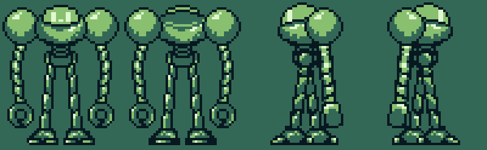

# sprite-rigger

Animate pixel-art sprites from a few still poses. An AI model builds the skeleton and writes the motion; a small local engine draws every frame pixel-exact, in your palette, at any frame count. Built for weak laptops: the app is Python + numpy + Pillow and a page in your browser.



## What it does

1. **Cuts the sprite into regions.** Pixel art draws parts as fills inside an outline, so the outline tells where the parts are. No AI needed.
2. **Builds a skeleton.** A vision model looks at the numbered regions and groups them into parts (torso, head, arms, legs…) with joints, parents and draw order. You can edit the result as JSON.
3. **Writes the motion.** From a description ("heavy walk, head bobs late") the model writes short curves per part. The curves are resampled to any number of frames, so the same motion works at 4, 6, 8 or 12 frames.
4. **Draws the frames.** Parts move by whole pixels or turn with a pixel-art rotation (RotSprite); gaps at stretched joints are filled; colours never leave your palette.
5. **Touches up.** A rule-based cleanup pass closes outlines and removes stray pixels. An optional small local **refiner model** redraws rough spots. What still needs a human eye you paint in a built-in editor with onion skin; part **variants** (a bent knee, a fist) are drawn once and reused.
6. **Exports** strips, a sheet, GIF previews and metadata for GameMaker (works for any engine that reads strips/sheets).

## Run it

You need Python 3.10+.

```
git clone https://github.com/YOUR_NAME/sprite-rigger
cd sprite-rigger
run.bat           (Windows)      ./run.sh        (macOS / Linux)
```

The first run makes a virtual environment and installs numpy and Pillow. The browser opens at `http://127.0.0.1:8765`. Pass a folder to work in: `run.bat my_robot`.

Try the example: `run.bat examples/robot`.

## Model connections

Pick one in the left panel:

| Connection | What you need |
|---|---|
| **Claude Code** | Claude Code installed and signed in on this computer. The app runs `claude -p` in the background. |
| **Anthropic API** | An API key. |
| **OpenAI-compatible** | Any server that speaks the OpenAI chat API: OpenAI, OpenRouter, Gemini's OpenAI endpoint, DeepSeek, and local ones (Ollama, LM Studio, llama.cpp). Set the base URL, key and model. |

The model must accept images for skeleton building. Writing and fixing motions works with any text model. The key is saved only in the project's `settings.json`.

There is no request limit: providers show your usage, and local models have none. The one safeguard is for **auto-review**, where the model checks its own frames and revises: it stops after N rounds in a row (settings, default 3, 0 turns it off). The header shows requests and tokens used in this session.

## Settings

Frames, FPS, motion strength, margin around the sprite, fixed cell size (or fit), preview scale, cleanup on/off, refiner on/off, auto-review limit. Mirror rows on export (a left walk from the right one).

## The refiner model (experimental)

A small U-Net (~0.5 M parameters) that runs in numpy (~50 ms per frame on a laptop CPU). It only changes pixels the engine turned, stretched or swapped, and can only pick colours from your palette. Turn it on in the settings once `refiner.npz` is in the project folder or in `sprite_rigger/models/`.

It learns from hand-drawn walk cycles: the engine fakes a rough version of each real frame from the standing frame, and the model learns to turn the rough frame into what the artist drew.

**Status:** no weights ship with the repository yet. A short CPU run (6 000 samples, 4 000 steps) reached 82% of redrawn pixels right against 71% for the rough frame, but on the 4-colour example robot it still adds noise more often than it helps. It needs the full run on a GPU, and ideally sprites closer to your style in the data. Train it in a free Colab: open `training/train_refiner_colab.ipynb`, or locally:

```
pip install -r requirements-train.txt
python training/make_dataset.py <LPC spritesheets folder> data.npz 20000 2
python training/train.py data.npz sprite_rigger/models/refiner.npz --steps 30000
```

Honest limits even when trained: it cleans and fills; it does not invent a pose that is not there (a turn, a fall). Draw those, or draw a part variant and let the engine reuse it.

Training data: [Universal LPC Spritesheet Character Generator](https://github.com/LiberatedPixelCup/Universal-LPC-Spritesheet-Character-Generator) art (CC-BY-SA 3.0 / GPL 3.0 and others; authors in its `CREDITS.csv`). The art is not included in this repository.

## Files

```
sprite_rigger/
  segment.py    regions from outlines
  rig.py        skeleton, transforms, frame renderer
  rotsprite.py  pixel-art rotation
  motion.py     curves -> per-frame poses
  cleanup.py    rule-based tidy-up
  refiner.py    the small model, numpy inference
  autorig.py    prompts + validation for skeleton / motion / fixes
  ai.py         Claude Code, Anthropic, OpenAI-compatible connections
  server.py     local web app;  web/index.html  the page
  presets/      walk_front, walk_side, idle
training/       dataset builder, trainer (JAX), Colab notebook
examples/robot  a sample rig
```

Command line without the browser:

```
python -m sprite_rigger regions pose.png out/
python -m sprite_rigger animate examples/robot/rig.json --out out/ --anim down:front:walk_front --anim right:side:walk_side --mirror right:left --frames 8
```

## Rig format

```json
{"views": {"front": {"image": "front.png", "parts": {
  "torso": {"regions": [6, 7, 9], "pivot": [24, 29], "z": 3},
  "leg_l": {"regions": [20, 24], "pivot": [18, 30], "parent": "torso", "z": 1,
            "variants": {"bent": {"image": "variants/front_leg_l_bent.png"}}},
  "leg_far": {"clone_of": "leg_near", "offset": [0, 0], "shade": -1, "z": 0}
}}}}
```

Motion: `{"loop": true, "tracks": {"leg_l": {"dy": [0, -2, -3, -1, 0, 0, 0, 0], "rot": [...], "variant": ["", "bent", "", ""]}}}`. `dx`/`dy` in pixels, `rot` in degrees (clockwise), keys evenly spaced over one cycle.

## License

MIT. The example robot sprite belongs to its author and is included only as a demo.
